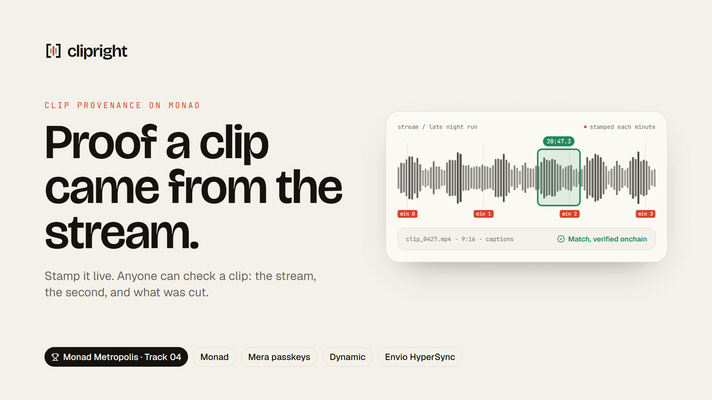
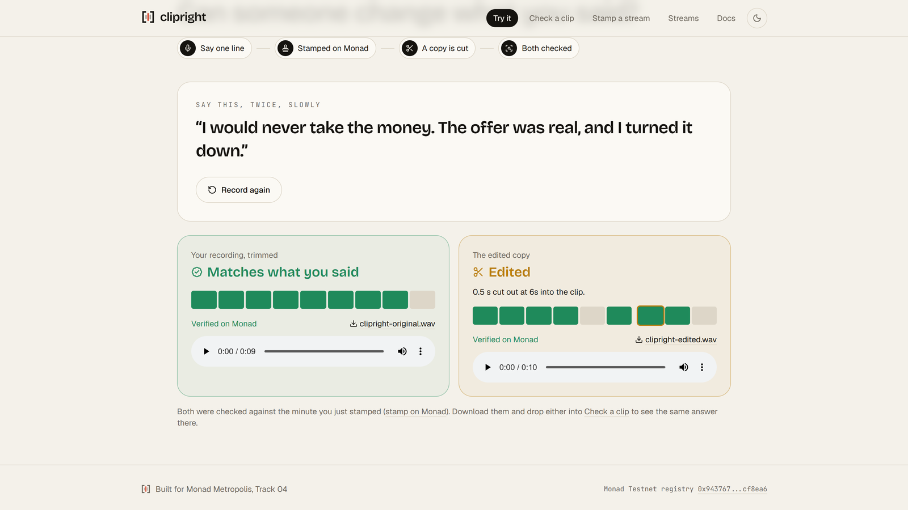
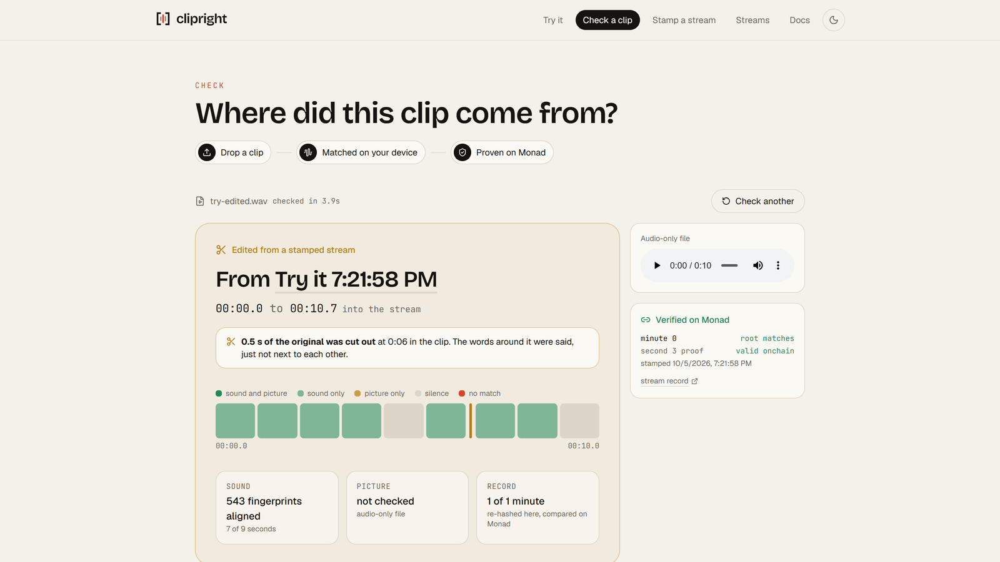
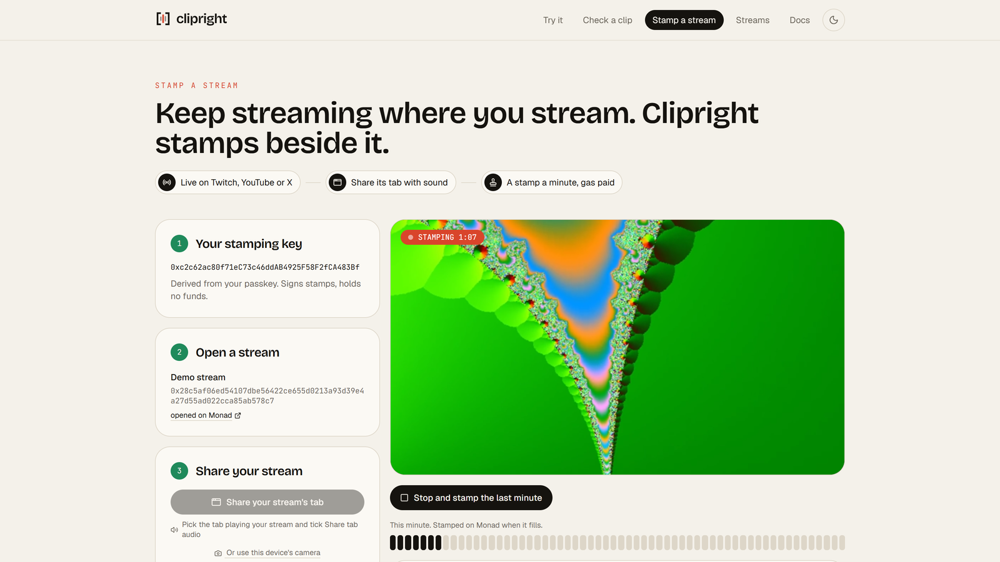
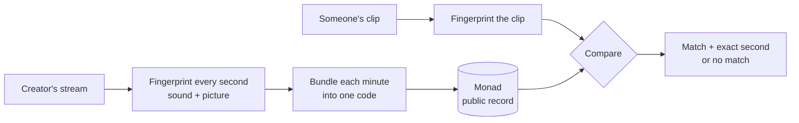

<p>
  <picture>
    <source media="(prefers-color-scheme: dark)" srcset="docs/mark-dark.svg">
    
  </picture>
</p>

# Clipright

**Proof that a clip really came from the stream, and whether anything was cut out.**

Most people never watch a livestream live. They see a 30-second clip of it, cut by someone else. Delete one word and "I would never take the money" becomes "I would take the money", and nobody watching can check.

Clipright stamps a stream on Monad while it is live, one code a minute. Later, anyone can drop in a clip and see which stream it came from, which second, and where it was cut or changed.

<p>
  <a href="https://clipright.vercel.app/try"><b>Try it in a minute</b></a> ·
  <a href="https://clipright.vercel.app/check">Check a clip</a> ·
  <a href="https://clipright.vercel.app/live">Stamp a stream</a> ·
  <a href="https://clipright.vercel.app/docs">Docs</a>
</p>

Live on Monad testnet. Built solo by Austin Chris for Monad Metropolis, Track 04: Trust, Identity & AI Infrastructure.



---

## How it works, in three steps

| | Step | What happens |
|---|---|---|
| 1 | **Stamp** | A creator keeps streaming on Twitch, YouTube or X. Clipright runs in a browser tab beside it, listens to the stream, and every minute writes one short code on Monad. |
| 2 | **Clip** | Someone cuts a clip, crops it to vertical, adds captions and posts it. |
| 3 | **Check** | Anyone drops the clip into Clipright. It answers: which stream, which second, and what was cut out or added. The answer is checked against Monad itself, not against Clipright's word. |

The video is never uploaded. Only fingerprints are made, in the browser, and only one code a minute goes onchain.

### Try it yourself in a minute

Say one sentence into your microphone. Clipright stamps it on Monad, makes a copy with a word cut out, and checks both:



### What a check looks like

Each second of the clip is lined up with the stamped stream. Green means it matches; the gold line is where something was cut:



### Stamping a stream

Share the tab your stream plays in. A passkey (Face ID, a fingerprint or your PIN) makes the key that signs each stamp, and Clipright pays the gas. No wallet or crypto needed.



## Why it matters

- **Clips are how people see streams.** TikTok, Shorts, Reels and X carry the moment, not the stream.
- **Editing is effortless now,** and clipping is a paid job: campaigns pay editors per view.
- **The only check today is someone eyeballing it** inside one platform, after the damage is done. Tools like YouTube's Content ID are closed to most creators and work on one platform only.

## Why Monad

- **Cheap enough to stamp every minute.** A six-hour stream is 360 stamps, about $0.10 at testnet fees (0.0107 MON a stamp, MON at $0.027 to $0.029 in early October 2026).
- **Final in under a second.** Blocks every 0.3 s, final in about 0.6 s, so a minute is settled long before anyone can cut and post a clip from it.
- **Anyone can check.** A clip is checked against the public record on Monad, not a promise from a server.

Could it run on another chain? Yes, the contract is plain Solidity. Monad is where all three needs meet: Ethereum mainnet costs too much per minute, rollups' fast confirmations are a sequencer's promise until the batch settles, and 10,000 streams stamping every minute is about 170 transactions a second.

## What it does not do

- **It is not a deepfake detector.** It vouches for what it witnessed. A video nobody stamped cannot be judged.
- **No record does not mean fake.** A clip from an unstamped stream gets "No Clipright record. That doesn't make it fake." Find a lead can then suggest where it is from, clearly labelled as a lead, not proof.
- **A stamp proves when, not who.** Anyone can stamp a tab. A stamp proves those fingerprints existed at that minute and which key signed them. Linking a wallet names the key.
- **Swapped audio weakens the match.** If a clip replaces the stream's sound, only the picture is left to match.

## Who it is for

- **Creators** who want a public record of what they actually said.
- **Viewers and journalists** checking a viral clip before sharing it.
- **Clippers** proving their clip is a faithful cut, with a shareable link that re-checks Monad for every visitor.
- **Monad teams** running AMAs and Spaces, and clipping campaigns that check sources by hand today.

## What works today

| Feature | Status |
|---|---|
| Stamp a stream from a shared tab or a camera, one signed stamp a minute | Live |
| Check a clip: which stream, which second, re-checked on Monad in the browser | Live |
| Cut and splice detection: names what was cut out or added, and where | Live |
| Vertical crops, captions and re-encoding still match | Live, see the test clips below |
| Shareable verified links (`/v/<id>`) with a preview card on X | Live |
| Passkey stamping key (Mera), gas paid by Clipright's relayer | Live in Chrome; not yet tried on a physical phone |
| Link a wallet to your stamping key (Dynamic), public creator pages | Live |
| Full stream history through Envio HyperSync | Live |
| Find a lead for clips that are not on record | Live, labelled as a lead |

### The test clips

A reference stream is stamped on the live registry. Download these from [the docs](https://clipright.vercel.app/docs/test-it#clips) and drop them into [Check a clip](https://clipright.vercel.app/check):

| Clip | What was done to it | Result |
|---|---|---|
| A | 9:16 centre crop, burned-in captions, re-encoded | Matched at 47.297 s (true start 47.3 s) |
| B | Same pictures, soundtrack replaced | Sound missed; pictures matched at 47.25 s |
| C | Unrelated video | No match |
| D | Landscape, scaled to 480p, low bitrate | Matched at 88.602 s (true start 88.6 s) |
| E | 5 seconds of unrelated footage spliced in | Matched; the 5 spliced seconds flagged |

All demo footage was recorded by us. Clipright does not capture other people's streams.

## Built with

| | Used for |
|---|---|
| [Monad](https://monad.xyz) | The public record of minute stamps, and onchain proof checks (`verifySecond`) |
| [Mera](https://github.com/category-labs/mera) | The stamping key, made from a passkey. It signs stamps and holds no funds |
| [Dynamic](https://www.dynamic.xyz) | Connecting a creator's wallet and linking it to their stamping key, so a match names the creator |
| [Envio HyperSync](https://docs.envio.dev/docs/HyperSync/overview) | The full event history of both contracts, beyond the public RPC's 100-block log limit |
| [Gemini](https://ai.google.dev), Whisper on [Groq](https://groq.com), [Wikiquote](https://en.wikiquote.org), [trace.moe](https://trace.moe) | Leads for clips that are not on record |

The sound fingerprinting (in the style of Shazam and [audfprint](https://github.com/dpwe/audfprint)) and the picture hash (in the style of [PDQ](https://github.com/facebook/ThreatExchange)) are written from scratch in TypeScript. How each piece is used, with links to the code: [docs/built-with](https://clipright.vercel.app/docs/built-with).

## Contracts on Monad testnet

| Contract | Address |
|---|---|
| StampRegistry | [`0x943767372469F18D9635A10b2C42CbC8f0cF8Ea6`](https://testnet.monadscan.com/address/0x943767372469F18D9635A10b2C42CbC8f0cF8Ea6) ([verified source](https://sourcify.dev/server/repo-ui/10143/0x943767372469F18D9635A10b2C42CbC8f0cF8Ea6)) |
| CreatorLinks | [`0xDB4DE12eEbb8f935DaC60b59673D83c44A3c33EF`](https://testnet.monadscan.com/address/0xDB4DE12eEbb8f935DaC60b59673D83c44A3c33EF) |

---

## For developers

### Under the hood



- **Sound first.** Clips almost always keep the stream's audio. Like song-recognition apps, Clipright picks distinctive points in the sound, so it can find a short excerpt inside hours of audio and say exactly where it starts. Captions, cropping and re-compression do not change the sound.
- **Picture second.** A vertical clip throws away about two thirds of a widescreen frame, so the picture is fingerprinted twice in advance: the full frame and the centre vertical crop.
- **One code per minute.** Each minute's fingerprints become one Merkle root. Any single second can later be proven to belong to it without publishing the rest.
- **Signed by the creator.** Each minute is signed by the passkey-derived key. The relayer submits it and pays the gas, and the contract rejects any stamp the stream's key did not sign. A minute cannot be stamped before it could have started.
- **Gas protection.** The relayer refuses work past a per-hour open limit, a per-day stamp limit, a 240-minute stream cap or a low-balance floor, counted from onchain events.

### Run it

Needs Node 22 or newer and pnpm.

```bash
pnpm install
pnpm gate                                   # matcher gate on a synthetic stream
pnpm test                                   # engine and contract tests

# local devnet
cd packages/contracts && npx hardhat node   # terminal 1
pnpm deploy:local                           # terminal 2, from packages/contracts
cd apps/web && NEXT_PUBLIC_CHAIN_ID=31337 pnpm dev
```

Settings are read from `.env` at the repo root (see [`.env.example`](.env.example)): `RELAYER_KEY` pays gas for stamps; `ENVIO_HYPERSYNC_KEY`, `DATABASE_URL_POOLED` (Postgres; without it files go to `apps/web/data`), `GEMINI_API_KEY`, `GROQ_API_KEY` and `NEXT_PUBLIC_DYNAMIC_ENV_ID` are optional. The registry address comes from `packages/contracts/deployments/<chainId>.json`.

**Make your own test clips** from a recording downloaded on the Stamp a stream page:

```bash
node packages/engine/scripts/make-clips.ts clipright-recording.webm 40   # start 40 s in
```

This writes a vertical captioned copy, a copy with the sound swapped and an unrelated clip into `clips/`.

### Layout

- `packages/engine`: fingerprinting, matching and Merkle proofs in plain TypeScript; the same code runs in the browser and in Node.
- `packages/contracts`: `StampRegistry.sol` (one stamp per stream minute) and `CreatorLinks.sol` (wallet to stamping key), with tests, including one proving the TypeScript engine and the contract build identical proofs.
- `apps/web`: the Next.js app with Try it, Check a clip, Stamp a stream, stream records, shareable links and the relayer API. Hosted on Vercel; fingerprints live in Postgres on Neon.

Full docs, including use cases and the contract and API reference: [clipright.vercel.app/docs](https://clipright.vercel.app/docs).

## Glossary

- **Fingerprint:** a compact summary of a second of sound or picture that stays the same after cropping, captions or compression, within limits.
- **Merkle root:** one short code standing for a whole minute of fingerprints. Any single second can be proven to belong to it.
- **Passkey:** the Face ID, fingerprint or PIN login built into phones and laptops.
- **The mark:** two brackets closing on one bar, a clip locking onto the exact second it came from.
